<a href="https://amsengine.dev"></a>

[](https://amsengine.dev)
[](https://www.linkedin.com/in/evertamsenga)


## 👋 About me

```ts
const evert = {
  currentlyLearning: "Astro",
  askMeAbout: ["TypeScript", "Arduino and C++", "automation"],
  openTo: "full-time",
  timezone: "SAST (UTC+2)",
};
```

## 🛠️ Tech I use

<table>
  <tr>
    <td><b>Languages</b></td>
    <td>      </td>
  </tr>
  <tr>
    <td><b>Frameworks and libraries</b></td>
    <td>     </td>
  </tr>
  <tr>
    <td><b>Hardware, platforms and data</b></td>
    <td>      </td>
  </tr>
  <tr>
    <td><b>Testing and tools</b></td>
    <td>   </td>
  </tr>
  <tr>
    <td><b>My setup</b></td>
    <td>       </td>
  </tr>
</table>

## 🎓 Certifications

<table>
  <tr>
    <td align="center" width="20%"><a href="https://www.credly.com/badges/69316c3d-acab-4fe4-b71f-961ab651314d/linked_in_profile"></a><br><sub><b>CompTIA A+ ce</b><br>CompTIA · 2020</sub></td>
    <td align="center" width="20%"><br><sub><b>The Complete Google Ads Masterclass</b><br>Udemy · 2026</sub></td>
    <td align="center" width="20%"><br><sub><b>Waze Ads Fundamentals</b><br>Google · 2022</sub></td>
    <td align="center" width="20%"><a href="https://www.credly.com/badges/8c998c00-79ff-4aaa-8400-e4b2f8daa416/linked_in_profile"></a><br><sub><b>Pearson Word Introductory</b><br>Pearson</sub></td>
    <td align="center" width="20%"><a href="https://www.credly.com/badges/8a1b0c3b-ef97-4b2a-8f91-646f6b3720dd/linked_in_profile"></a><br><sub><b>Pearson PowerPoint Introductory</b><br>Pearson</sub></td>
  </tr>
</table>

<a href="https://amsengine.dev"></a>
