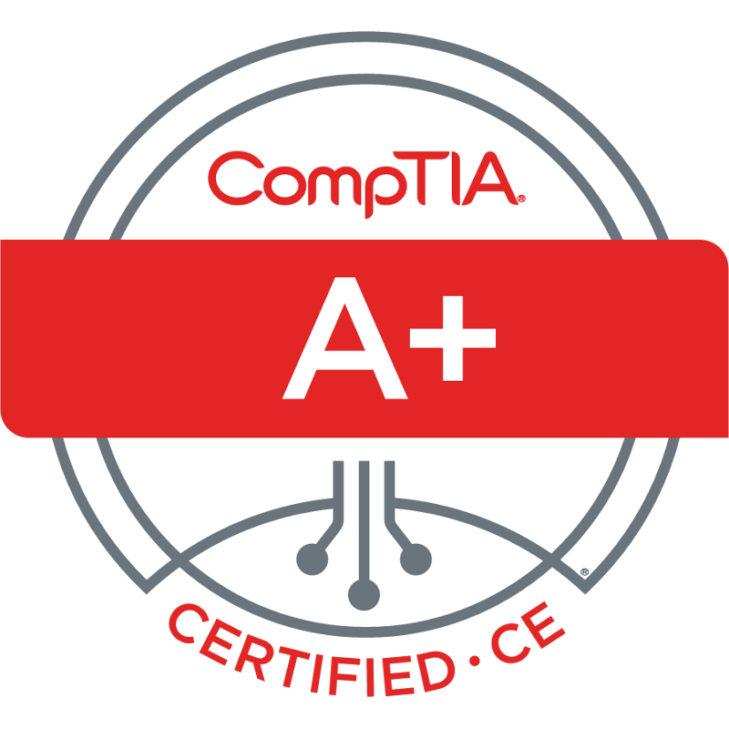
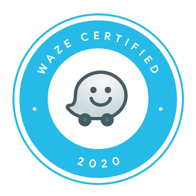

Software developer building desktop apps, firmware, APIs and the automation that connects them.
BSc Information Technology (Software Engineering).

**Portfolio and project write-ups: [amsengine.dev](https://amsengine.dev)**

## What I'm building

- **FieldWarden**: monitors electric fence energisers in real time. C++ Arduino firmware, a PySide6 desktop app with a fence map, and USB relay control for the alarm siren, covered by 450+ pytest tests.
- **Internal operations tools**: tracking apps, serverless APIs and document data-extraction tools for a multi-branch business.
- **Websites**: a custom WordPress theme for a truck dealership, built from scratch.

Most of this lives in private repositories, so the [portfolio](https://amsengine.dev/projects) has the details.

## Tech I use

**Languages**

     

**Frameworks and libraries**

     

**Hardware, platforms and data**

      

**Testing and tools**

   

## Certifications

- [CompTIA A+ ce](https://www.credly.com/badges/69316c3d-acab-4fe4-b71f-961ab651314d/linked_in_profile) · CompTIA · 2020
- The Complete Google Ads Masterclass · Udemy · 2026
- Waze Ads Fundamentals · Google · 2022
- [Pearson Word Introductory](https://www.credly.com/badges/8c998c00-79ff-4aaa-8400-e4b2f8daa416/linked_in_profile) · Pearson
- [Pearson PowerPoint Introductory](https://www.credly.com/badges/8a1b0c3b-ef97-4b2a-8f91-646f6b3720dd/linked_in_profile) · Pearson
